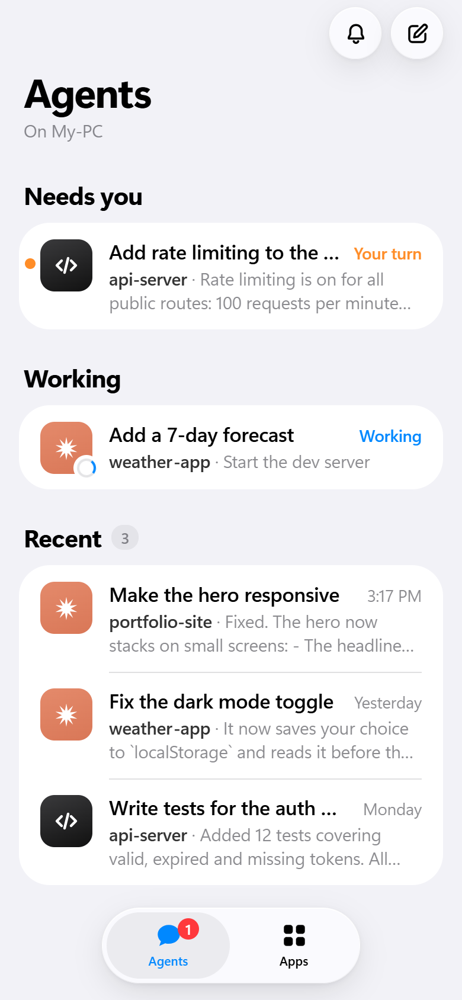
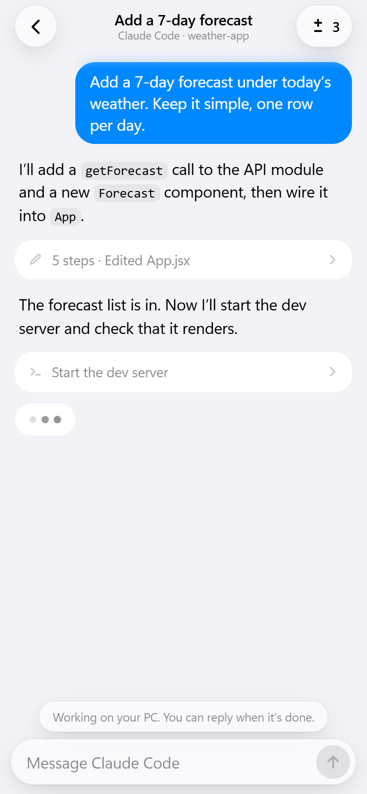
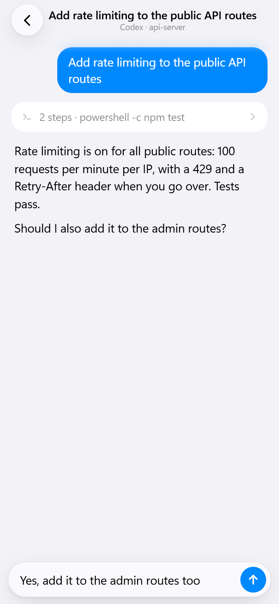
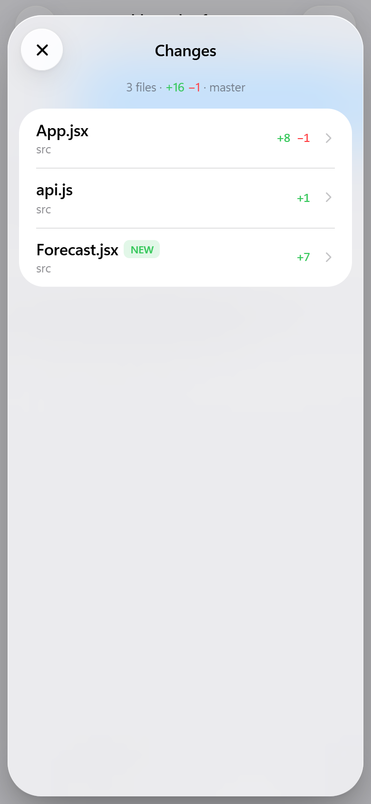
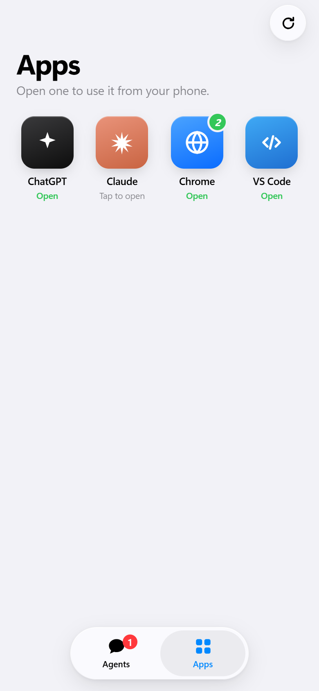
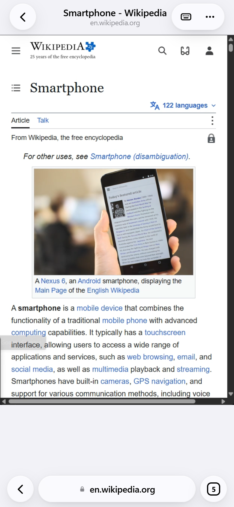
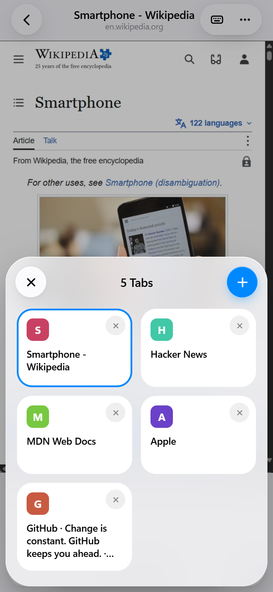
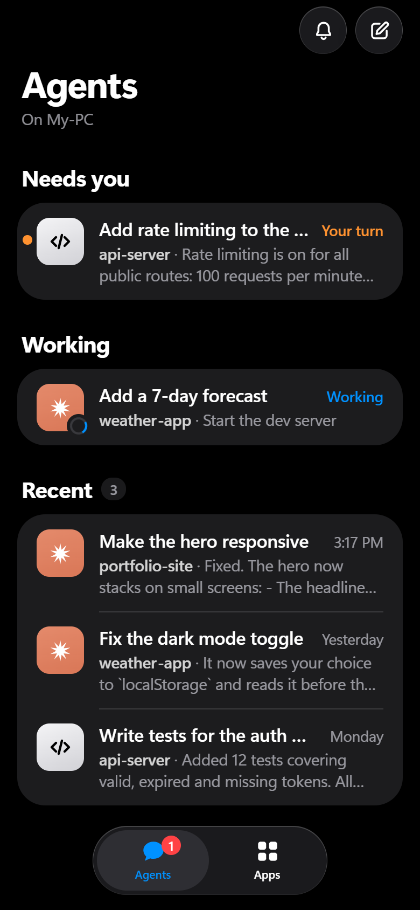

# Remote PC

**Your coding agents, your apps and your browser, on your phone. From anywhere.**

You start Claude Code or Codex on your PC, walk away, and want to check on it from the couch, the train or class. Remote PC turns your phone into a clean, iPhone-style control panel for everything running on your computer:

- **Agents**: every Claude Code and Codex conversation on your PC as a chat, including ones started in VS Code, a terminal, PowerShell or the Codex app. Read along live, reply to keep it going, **interrupt it mid-run** and redirect it, start new agents.
- **Notifications**: your phone buzzes when an agent finishes, needs you, or hits a problem. Tap it and you land in that conversation.
- **Changes**: see exactly what an agent edited, file by file, as a diff.
- **Preview**: open any site an agent is running on `localhost` right on your phone.
- **Apps**: use ChatGPT, Claude, Chrome, VS Code (or any other open window) from your phone. Each window is resized to phone shape and streamed as low-latency video. Tap, scroll, and type with your phone keyboard, which pops up automatically when you tap a text box.
- **Chrome like Safari**: your real Chrome with your real logins, shown edge to edge with a Safari-style address bar and tab switcher. Sites switch to their mobile layout.
- **Pair with a QR code.** No app store and no browser extension. It's a web app you add to your home screen.

It runs entirely on your own machine. Remote access goes through [Tailscale](https://tailscale.com) (free for personal use), so nothing is exposed to the public internet.

<table>
  <tr>
    <td align="center"><br><sub>Every agent on your PC</sub></td>
    <td align="center"><br><sub>Follow along live</sub></td>
    <td align="center"><br><sub>Answer when it needs you</sub></td>
    <td align="center"><br><sub>See what it changed</sub></td>
  </tr>
  <tr>
    <td align="center"><br><sub>Your desktop apps</sub></td>
    <td align="center"><br><sub>Your real Chrome, phone-sized</sub></td>
    <td align="center"><br><sub>Safari-style tabs</sub></td>
    <td align="center"><br><sub>Light and dark</sub></td>
  </tr>
</table>

<sub>Screenshots are the real phone app running against sample projects.</sub>

## Why not just use…

There are good tools in this space. Here's how they differ (as of late 2026):

| | **Remote PC** | Claude Code [Remote Control](https://code.claude.com/docs/en/mobile) | Codex in the ChatGPT app | [Happy](https://github.com/slopus/happy) / [Omnara](https://apps.apple.com/app/id6748426727) | Remote desktop (Chrome Remote Desktop, RDP, AnyDesk…) |
|---|---|---|---|---|---|
| Claude Code **and** Codex in one place | ✅ | Claude only | Codex only | ✅ | – |
| Shows sessions you **already started**, in any terminal or VS Code, with no special launch | ✅ | Start Remote Control in each session | – | Start sessions through their CLI | – |
| Start new agents from the phone | ✅ | ❌ (sessions start on the computer) | ✅ | ✅ | – |
| Diffs and `localhost` previews on the phone | ✅ | – | – | – | Squint at the desktop |
| Use desktop apps and your logged-in Chrome | ✅ phone-shaped windows | ❌ | ❌ | ❌ | ✅ but a shrunken full desktop |
| Your traffic stays on your own devices | ✅ via Tailscale (notifications are end-to-end encrypted Web Push) | Through Anthropic | Through OpenAI | Encrypted relay (Happy) | Through the vendor |
| Platforms | Windows PC | Any | Any | Any | Any |
| Price | Free, open source | With a Claude plan | With a ChatGPT plan | Happy is free and open source | Mostly free for personal use |

**The short version:** agent apps give you a nice chat but only for the agents they wrap, and only if you started them their way. Remote desktop gives you everything but squeezes a 1920px desktop onto a phone. Remote PC sits in between: one clean phone app for every agent already running on your PC, plus phone-shaped access to the apps those agents work in.

**Use something else if** you're on macOS or Linux (Remote PC is Windows-only for now), you only use Claude Code and want zero setup (Remote Control is built in), or you need to control a machine you can't install Tailscale on.

> **Platform:** Windows 10/11. The phone side works on any modern phone browser and is designed for iPhone.

---

## Contents

- [Why not just use…](#why-not-just-use)
- [Requirements](#requirements)
- [Install](#install)
- [Pair your phone](#pair-your-phone)
- [Use it from anywhere (Tailscale)](#use-it-from-anywhere-tailscale)
- [Using it](#using-it)
- [Keep it running](#keep-it-running)
- [Configuration](#configuration)
- [How it works](#how-it-works)
- [Security](#security)
- [Troubleshooting](#troubleshooting)
- [Contributing](#contributing)
- [License](#license)

## Requirements

| What | Why | Install |
|---|---|---|
| Windows 10 or 11 | Window capture and input use Windows APIs | |
| [Node.js](https://nodejs.org) 18+ | Runs the server | `winget install OpenJS.NodeJS.LTS` |
| [FFmpeg](https://ffmpeg.org) | Streams app windows to your phone | `winget install Gyan.FFmpeg` |
| [Tailscale](https://tailscale.com) | Reach your PC from anywhere, with HTTPS | `winget install Tailscale.Tailscale` + the iOS/Android app |
| [Claude Code](https://docs.claude.com/en/docs/claude-code) and/or [Codex CLI](https://github.com/openai/codex) | Only needed to *reply to* or *start* agents from your phone. Viewing conversations works without them. | `npm i -g @anthropic-ai/claude-code` / `npm i -g @openai/codex` |

An NVIDIA or Intel GPU is used for video encoding automatically when available (NVENC / Quick Sync). Otherwise it falls back to the CPU.

## Install

```powershell
git clone https://github.com/<you>/remote-pc.git
cd remote-pc
npm install
npm start
```

On first start it creates `~/.remote-pc/config.json` with a random access key and prints a QR code.

## Pair your phone

1. Open **http://localhost:7420/pair** on the PC. A large QR code appears.
2. Scan it with your phone's camera and open the link. You're signed in.
3. **iPhone:** Share → **Add to Home Screen**. **Android:** ⋮ → **Add to Home screen**.

From now on, just tap the icon.

Pairing only works from the PC itself, so nobody can pull the QR code from another device.

## Use it from anywhere (Tailscale)

Without Tailscale it works on your home Wi-Fi only. With it, it works from anywhere and the window video gets smoother (phones only allow hardware video decoding over HTTPS).

1. Install Tailscale on the PC and your phone, and sign in to the **same account** on both.
2. Turn on **HTTPS certificates** for your tailnet in the [Tailscale admin console → DNS](https://login.tailscale.com/admin/dns). Turn on **Serve** too if Tailscale asks.
3. On the PC, run:
   ```powershell
   powershell -ExecutionPolicy Bypass -File scripts\enable-https.ps1
   ```
   This serves Remote PC at `https://<pc-name>.<tailnet>.ts.net`, visible only to your own devices.
4. Restart Remote PC and pair again from **http://localhost:7420/pair**. The QR code now uses the HTTPS address.

Optional: block everything except Tailscale at the firewall (run from an **admin** PowerShell):

```powershell
powershell -ExecutionPolicy Bypass -File scripts\firewall.ps1
```

## Using it

### Agents
- The list shows what **needs you** (the agent asked a question), what's **working**, and recent conversations.
- Open one to read it as a chat. Tool calls are grouped into tidy "steps" you can expand.
- **Reply** to continue the same session.
  - **Open in a terminal on your PC** (including VS Code's terminal)? Your message is typed straight into that terminal, so it's one conversation and you see it on the PC as it happens. You can message it while it's working, and Claude Code reads it next. ■ presses Esc there to stop it.
  - **Not open anywhere?** It continues in the background with the agent's own CLI. If a run you started from the phone is still going, a new message **interrupts it** and sends your new instructions.
- **±** shows the changes in the project (git diff). **▶** opens a site the agent is running.
- **✎** (top right of the list) starts a new Claude Code or Codex agent in any project folder. **Full access** lets it run commands without asking.

> Live typing works for Claude Code sessions open in a terminal. Sessions in the Claude Code VS Code side panel, the Codex app or the Codex VS Code extension get your reply in the background, and that window shows it once you reopen the conversation.

### Notifications
- Tap the **bell** on the Agents screen and allow notifications. A test notification arrives right away.
- From then on you get one when an agent **finishes**, **needs you** (it asked a question) or **hits a problem**. Tap it to open that conversation.
- Tap the bell again to send another test or turn them off.
- **iPhone:** this needs iOS 16.4 or later, the app added to your **Home Screen** (open it from there, not from Safari), and the secure `https://…ts.net` address from [the Tailscale step](#use-it-from-anywhere-tailscale).
- Notifications are sent through Apple's/Google's standard Web Push service, end-to-end encrypted, so they can't read them. Your PC needs internet access to send them.

### Apps
- Tap an app to open it on your phone. If it isn't running, it gets launched.
- **Tap** = click, **drag** = scroll, **press and hold** = right-click.
- Tap a text box and your keyboard opens. A key row adds return, delete, esc, tab, arrows, copy/paste and undo. If the keyboard can't open by itself, a **Tap to type** button appears.
- While you view a window, it's moved to the right side of your PC screen at phone size. It goes back where it was when you leave.
- **⋯** → *Show at desktop size* turns phone sizing off.

### Chrome
- Only the web page is shown. The bottom bar has **back**, the **address** (tap to search or type a site) and **tabs**.
- The tab switcher lists your real Chrome tabs: tap to switch, ✕ to close, + for a new one.
- While you browse from the phone, Chrome's own toolbar is moved just above the top of your PC screen so the page gets the full height. It's restored when you leave.

## Keep it running

- **Start automatically at login** (hidden, restarts if it crashes):
  ```powershell
  powershell -ExecutionPolicy Bypass -File scripts\autostart.ps1
  ```
  Add `-Admin` (from an admin PowerShell) to also control admin windows such as Task Manager. `-Remove` uninstalls it.
- **Don't let the PC sleep while plugged in:** `powercfg /change standby-timeout-ac 0`
- Logs: `~/.remote-pc/server.log`

## Configuration

`~/.remote-pc/config.json`:

| Key | Default | Meaning |
|---|---|---|
| `port` | `7420` | Main app |
| `previewPort` | `7421` | Preview proxy for agent sites (served at `:8443` over Tailscale HTTPS) |
| `host` | `0.0.0.0` | Interface to listen on |
| `token` | random | The access key. Delete it and restart to sign out every device. |
| `vapid` | generated | Keys that identify your PC to the push services, for notifications |
| `pushSubject` | `https://github.com/remote-pc` | Contact URL sent with notifications. Must be a real-looking `https:` or `mailto:` address: Apple rejects `localhost`. |

Environment variables:

| Variable | Meaning |
|---|---|
| `RPC_CLAUDE_BIN` | Path to `claude.exe` (or `cli.js`) if it isn't found automatically |
| `RPC_CODEX_JS` | Path to Codex's `bin/codex.js` if it isn't found automatically |
| `RPC_PORT`, `RPC_PREVIEW_PORT` | Override the ports for one run (not saved) |

## How it works

```
 phone (web app) ──HTTPS / WebSocket──▶ Tailscale ──▶ server.js (Node, on your PC)
                                                        ├─ lib/agents.js     reads ~/.claude and ~/.codex session files,
                                                        │                    replies via `claude -p --resume` / `codex exec resume`
                                                        ├─ lib/workspace.js  git changes, running localhost sites
                                                        ├─ lib/push.js       phone notifications when an agent finishes or needs you
                                                        ├─ lib/preview.js    reverse proxy so localhost sites open on the phone
                                                        ├─ lib/apps.js       ffmpeg window capture → H.264 (or JPEG) over WebSocket
                                                        └─ lib/win.ps1       Win32 + UI Automation: windows, input, text boxes, Chrome tabs
```

- **Agents** are read straight from the files Claude Code (`~/.claude/projects`) and Codex (`~/.codex/sessions`) already write, so conversations from any editor or terminal show up.
- **Replies:** Claude Code lists its running sessions in `~/.claude/sessions`. If the conversation is open in a terminal, a tiny helper (`lib/inject.cs`, compiled on first use with the C# compiler built into Windows) writes your message into that terminal's input, as if typed. Otherwise the agent's own CLI resumes the session in the background, detached so it survives a Remote PC restart.
- **App windows** are kept on top while you view them, and captured with FFmpeg's Desktop Duplication grabber, encoded to H.264 (hardware when available) and decoded on the phone with WebCodecs. If the link slows down, the server skips ahead to the next keyframe instead of building up lag.
- **Keyboard:** Windows UI Automation maps where the text boxes are, so a tap on one can open the phone keyboard immediately (iOS only allows that during the tap itself).
- **Chrome:** UI Automation reads the address bar and tab strip. The page area is cropped from the window, and navigation uses Chrome's keyboard shortcuts.

## Security

Remote PC gives whoever has the access key **control of your computer**. Treat it like a password.

- The key is a random 192-bit token, stored in an HttpOnly cookie on your phone. Wrong keys are rate-limited.
- Pairing (`/pair`) only works from the PC itself.
- **Use Tailscale. Don't port-forward Remote PC to the internet.** With Tailscale Serve it's reachable only by devices signed in to your tailnet, over HTTPS.
- To revoke every device: delete `token` from `~/.remote-pc/config.json` and restart. To stop all notifications, delete `~/.remote-pc/push.json`.

Found a vulnerability? See [SECURITY.md](SECURITY.md).

## Troubleshooting

| Problem | Fix |
|---|---|
| Phone says it can't reach the PC | Is the server running? Is Tailscale on, on both devices? Try `http://localhost:7420` on the PC. |
| App window stays on "Opening…" | Install FFmpeg (`winget install Gyan.FFmpeg`) and restart. A minimized window is restored automatically. A full-screen game on top will cover it. |
| Video is choppy | Use the Tailscale HTTPS address (H.264 needs HTTPS). Check `tailscale status`: a direct connection is much faster than a relayed one. Some VPNs force relaying. |
| "Claude Code CLI not found" when replying | Install it globally, or set `RPC_CLAUDE_BIN`. |
| `tailscale serve` says Serve isn't enabled | Enable it in the Tailscale admin console, then rerun `scripts\enable-https.ps1`. |
| No notifications | On iPhone: open the app from the Home Screen icon (not Safari) over the `https://` address, and check Settings → Notifications → Remote PC. Then tap the bell → *Send a test*. |
| Can't click admin windows (Task Manager etc.) | Run Remote PC elevated (`autostart.ps1 -Admin`). |

## Contributing

Issues and pull requests are welcome. The code is plain Node.js and vanilla JS with no build step:

- `server.js`: HTTP routes, auth, WebSocket upgrade
- `lib/`: agents, apps (video), preview proxy, workspace, and the PowerShell window helper
- `public/`: the phone app (`index.html`, `style.css`, `app.js`), styled after iOS 26

Run `npm start`, open `http://localhost:7420/pair`, and test on a real phone. Please keep the phone UI simple: one obvious action per screen.

Ideas: macOS/Linux support, live replies into the Codex app, more agent CLIs (Gemini, Aider), file browser.

## License

[MIT](LICENSE)
